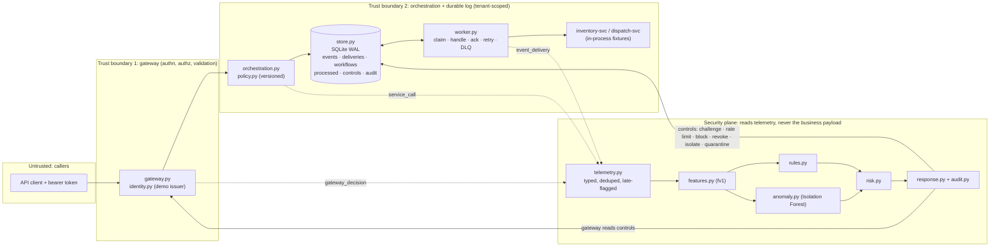

# Architecture

Companion design, derived from the component list in the paper's abstract. Details the abstract does not give
(estimator, formula, rule set, broker) are companion choices; see `docs/paper-map.md`.

## Components and trust boundaries



* **Boundary 1 (gateway).** Everything inbound is untrusted until the token verifies (HMAC, issuer, expiry), the
  principal is not revoked/blocked/challenged/rate-limited, the route exists, the scope is held, the tenant claim
  equals the token tenant, and the body validates (pydantic, `extra=forbid`, size cap 8 KiB). Only then is a workflow
  started. Decisions are recorded without token or body.
* **Boundary 2 (tenant scope).** Event ids, deliveries, telemetry keys, controls, actions and idempotency keys are all
  keyed by tenant. The same local principal id or event id in two tenants never collides; response actions name a tenant.
* **Security plane.** Consumes typed telemetry only. It cannot read payloads, and its only write path into the
  business system is the `controls` table and delivery quarantine, each audited.
* **Demo identity.** `identity.py` is a signed-token fixture, not an identity provider. The signing key is a published
  constant; override with `SEDEI_DEMO_ISSUER_KEY`. The server binds to `127.0.0.1` by default.

## Acknowledgement semantics

Delivery is **at-least-once**; business effects are **exactly-once by idempotent consumers**.

1. `claim` leases a delivery (`state=leased`, `attempts+1`, `lease_expires`).
2. The consumer step is **one transaction**: insert into `processed(consumer, tenant, event_id)` (primary key) →
   business effect → workflow transition (compare-and-set on current state, checked against the routing policy) →
   outgoing event + deliveries → telemetry. Any exception rolls all of it back.
3. After commit the worker `ack`s. A crash between 2 and 3 leaves the delivery leased; after the lease expires it is
   claimed again (`attempts=2`, broker-asserted `transport_redelivery=true`). The consumer finds its `processed` row,
   returns `duplicate`, and the worker acks. No second effect.
4. A handler exception → `nack`: exponential back-off, bounded by `max_attempts`, then `dead` + `dead_letters`.
5. A repeat of an `event_id` that is *not* explained by the broker (no assertion, or different payload hash or
   emitter) is a **security-relevant duplicate** (rule R3), not a redelivery.

## Failure paths

| failure | behaviour | test |
|---|---|---|
| crash after commit, before ack | lease expiry → redelivery → `duplicate` → ack; one effect | `test_restart_between_processing_and_ack_is_exactly_once` |
| exception mid-step | rollback of transition + event + processed mark | `test_transaction_rolls_back_transition_and_event_together` |
| concurrent writers on one workflow | one CAS wins, others `ConflictError` | `test_concurrent_updates_only_one_wins` |
| downstream service isolated by response | handler raises → retry → dead-letter | `test_worker_retries_then_dead_letters_on_isolated_service` |
| duplicate telemetry record | dropped and counted | `test_telemetry_ingest_dedup_and_late_flag` |
| late / out-of-order telemetry | visible only after receipt; same features regardless of arrival order | `test_out_of_order_and_duplicate_input_gives_identical_features` |
| model file tampered | SHA-256 mismatch → refuse to load | `test_anomaly_save_load_roundtrip_and_tamper_detection` |
| audit row altered | hash chain fails verification | `test_audit_chain_detects_tampering` |
| missing anomaly score | risk renormalises over rules + identity, `degraded=true` | `test_missing_anomaly_degrades_and_renormalises` |

## Clock conventions

| clock | used for | never compared with |
|---|---|---|
| `event_time` (producer, simulated epoch s) | when something happened | wall time |
| `receipt_time` (collector, simulated epoch s) | feature visibility, alert time, detection latency | wall time |
| `time.perf_counter()` (monotonic) | processing and benchmark latency (ms) | event/receipt time |
| `time.time()` | queue availability/lease only | simulated time (the demo uses `SimClock`) |

## Walkthrough sequence (trace 3, the incident fixture)

```mermaid
sequenceDiagram
  participant D as pre-authored fixture (data/)
  participant P as DetectionPipeline
  participant T as telemetry + features
  participant R as rules + anomaly + risk
  participant E as ResponseEngine
  participant S as store (controls, deliveries, audit)
  participant W as worker
  Note over S: victim tenant and other tenant each hold a pending event with the same event_id
  loop each record in receipt order
    D->>P: TelemetryRecord
    P->>T: ingest (dedupe, late flag), history as of receipt_time
    T->>R: FeatureVector fv1 (+ evidence ids)
    R->>P: findings, anomaly score, risk (components)
  end
  P->>E: Decision(event_quarantine, event:ev-…) [risk ≥ validation threshold]
  E->>S: one transaction: decision + action(committed) + quarantine victim delivery + audit
  D->>P: same record again (reprocess)
  P->>E: same Decision
  E-->>P: deduplicated (no new action, no new audit row)
  W->>S: drain
  S-->>W: other tenant's event processed; victim's event stays quarantined
```

Timestamps in the trace: `first_eligible_evidence`, `alert`, `policy_decision`, `committed` (simulated receipt clock, so
equal when the replay commits at the alert instant) plus monotonic `detect_ms`, `decide_ms`, `commit_ms`.
